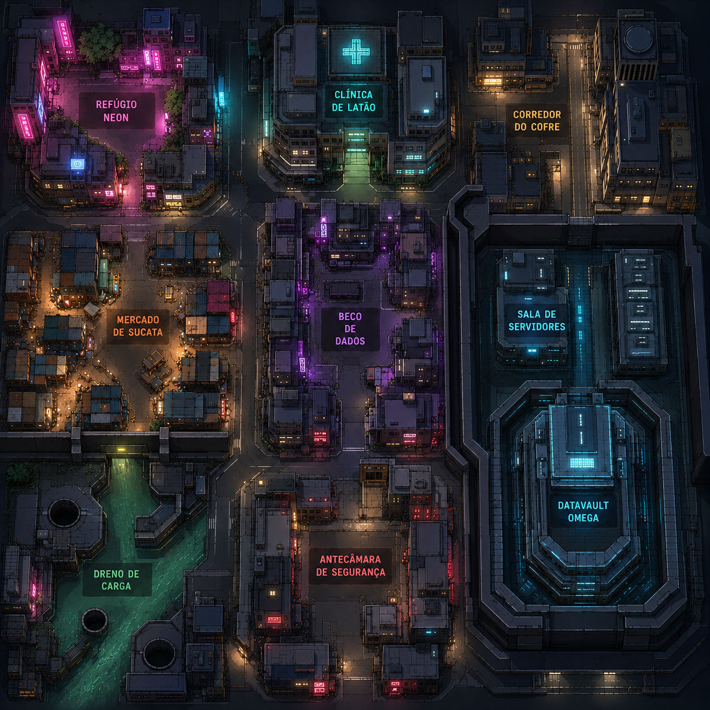

<p align="center">
  <a href="https://ashendesk.github.io/CHROME-TOMB-HUMAN-ERROR/">
    
  </a>
</p>

<h1 align="center">CHROME TOMB // HUMAN ERROR</h1>

<p align="center">
  <em>Dungeon-crawler de texto cyberpunk que roda direto no navegador.<br>
  Infiltre o Datavault Omega. Não acorde o ARCHON K-9.</em>
</p>

<div align="center">

[Clique aqui para jogar!](https://ashendesk.github.io/CHROME-TOMB-HUMAN-ERROR/)

</div>

<p align="center">
  
  
  
  
  
</p>

---

## Sumário

- [Sobre o jogo](#sobre-o-jogo)
- [Como jogar](#como-jogar)
- [Classes](#classes)
- [Regras](#regras)
- [Mundo e progressão](#mundo-e-progressão)
- [Rede de sentinelas](#rede-de-sentinelas)
- [Itens e lojas](#itens-e-lojas)
- [Comandos](#comandos)
- [Interface e dispositivos móveis](#interface-e-dispositivos-móveis)
- [Estrutura do repositório](#estrutura-do-repositório)
- [Desenvolvimento](#desenvolvimento)
- [Créditos e licença](#créditos-e-licença)
- [English summary](#english-summary)

## Sobre o jogo

Você é um operativo cibernético infiltrando o **Setor Alpha-7** para roubar dados do **Datavault Omega**. A superfície é um hub de nove setores vigiado por câmeras, guardas e drones. Sob os servidores, o **Núcleo K-9** esconde três andares de corredores sintéticos e, no fim deles, o **ARCHON K-9**: uma IA que ficou hostil "por experiência, não por padrão".

- **Terminal no navegador**: um único arquivo HTML, sem build, sem servidor, sem dependências.
- **Sistema OSR leve**: testes de d20 contra uma Dificuldade (DR), inspirado em CY_BORG / Mörk Borg.
- **Três classes** com perks próprios, **loja**, **hacking**, **ruído** como pressão constante e um **chefe final em duas fases**.
- **Texto em português**, jogável por botões (chips de ação) ou digitando comandos.

## Como jogar

**Localmente:** baixe o repositório e abra `index.html` em qualquer navegador moderno. Nada mais é necessário.

**Online (GitHub Pages):** em *Settings → Pages*, escolha *Deploy from a branch*, selecione a branch `main` e a pasta `/ (root)`. O jogo ficará disponível em `https://<seu-usuario>.github.io/<nome-do-repositório>/`.

**Primeiros passos:**

1. Escolha uma [classe](#classes).
2. Fale com **Morrow, Fixador** no Refúgio Neon para entender o trabalho.
3. Explore o hub com `move norte/sul/leste/oeste` (cada passo custa 1 PA).
4. Abra o caminho até os servidores, desça ao Núcleo K-9, derrote o ARCHON K-9 e volte ao Refúgio para `extrair`.

> **Dica:** o botão **AJUDA** e a aba **MISSÃO** dentro do jogo listam comandos e objetivos o tempo todo.

## Classes

| Classe | HP | Estresse (máx.) | ARM | Melee | Hack | Ranged | PA | Créditos |
|---|:-:|:-:|:-:|:-:|:-:|:-:|:-:|:-:|
| **Runner Fantasma** | 13 | 11 | 0 | +2 | +3 | +3 | 4 | 5 |
| **Crente de Cromo** | 17 | 9 | 1 | +4 | +1 | +1 | 4 | 6 |
| **Mago de Rua** | 11 | 13 | 0 | +1 | +5 | +2 | 4 | 8 |

| Classe | Perk | Kit inicial |
|---|---|---|
| Runner Fantasma | **Passo Fantasma**: a primeira fuga de cada combate é garantida. | 2 Stim Patch, 1 Granada de Fumaça |
| Crente de Cromo | **Oração de Máquina**: uma vez por combate, Estresse −1 e +2 no próximo ataque. | 1 Stim Patch, 1 Remendo Balístico |
| Mago de Rua | **Cold Boot**: o primeiro hack de cada combate ganha +3. | 1 Stim Patch, 1 Fragmento de Overclock |

## Regras

### Atributos e recursos

| Recurso | Função |
|---|---|
| **HP** | Pontos de vida. Em 0, fim de jogo. |
| **Estresse** | Pressão mental. Ao atingir o máximo: em combate, você perde a próxima ação; fora dele, sofre um **Colapso Nervoso** (perde um item, +2 de Ruído ou um tremor que penaliza o próximo confronto). |
| **Armadura (ARM)** | Reduz o dano recebido. |
| **Melee / Hack / Ranged** | Modificadores de ataque corpo a corpo, intrusão/varredura e disparo. O Ranged também define a esquiva passiva (DR = 10 + Ranged) e a iniciativa. |
| **PA** | Pontos de Ação, funcionam como mana: mover, avançar e hackear gastam PA. Descanse ou use Células de Bateria para recuperar. |
| **Ruído** | Alerta do setor (0–10). No máximo, um **Esquadrão de Resposta** converge sobre você. Vencê-lo reduz o Ruído em 6. |
| **Créditos** | Moeda para lojas e suborno. |

### Iniciativa

`d6 + Ranged`. Resultado **≤ 4**: o inimigo age primeiro. **≥ 5**: você age primeiro.

### Combate

| Ação | Rolagem | Custo |
|---|---|---|
| **Atacar** | d20 + Melee vs DR (12 + ARM do inimigo) | — |
| **Hackear** | d20 + Hack vs DR (12 + ARM do inimigo) | 1 PA |
| **Varredura** | d20 + Hack vs DR (12 + ARM do inimigo) | 1 PA |
| **Disparar (Pistola)** | d6 define a rajada (1 = trava, 2–6 = 1 a 5 tiros); cada tiro rola d20 + Ranged vs DR | 1 cartucho por tiro |
| **Disparar (Rifle)** | d8 + Ranged, tiro único (veja [Itens](#itens-e-lojas)) | 1 projétil .50 |
| **Usar item** | Efeito imediato | gasta o item |
| **Fugir** | Chance base de 40%, modificada por perks e itens | — |

- Um **20 natural** em ataque, hack ou disparo de pistola é crítico e dobra o dano.
- **Turno do inimigo:** d20 + ATK vs DR (10 + seu Ranged). Um 20 natural causa dano ×1,5.
- **Especiais de inimigos:** `bleed` (sangramento), `alarm` (+2 Ruído), `noise` (+1 Ruído), `mindspike` (+1 Estresse), `corrode` (+2 de dano, ignora ARM), `lockdown` (pode travar você por 1 turno), `swarm` (2 golpes) e `phase` (fase 2 do chefe, com ATK +1 e 25% de chance de dano dobrado).

### Descanso (d6)

| d6 | Resultado |
|:-:|---|
| 1–3 | Silencioso: HP +2, Estresse −2, PA no máximo. |
| 4–6 | Perturbado: HP +1, PA pela metade, Estresse +1d2, Ruído +1d3. |

Algumas zonas alteram o descanso: **Refúgio Neon, Mercado e Dreno** são calmos (Ruído −1); **Clínica e Beco de Dados** não alteram o Ruído; as demais são monitoradas.

## Mundo e progressão



### Mapa do hub (grade 3×3)

```
[0,0 Refúgio Neon] ─── [1,0 Clínica de Latão] ─── [2,0 Corredor do Cofre]
        │                       │                          │
[0,1 Mercado de Sucata] ─ [1,1 Beco de Dados]    [2,1 Sala de Servidores]
                                │                          │
[0,2 Dreno de Carga] ─── [1,2 Antecâmara] ──────── [2,2 Datavault Omega]
```

O Beco de Dados **não** conecta à Sala de Servidores (muro corporativo).

### Objetivos

1. **Comprometer os servidores** (Sala de Servidores).
2. **Abrir o Datavault Omega**: derrotar a Sentinela do Cofre, recuperar o Chip Omega e libertar o runner capturado.
3. **Descer ao Núcleo K-9.**
4. **Derrotar o ARCHON K-9** e recuperar a matriz de dados.
5. **Retornar ao Refúgio Neon e `extrair`.**

### Hacking de salas (hub)

| Sala | DR | Efeito |
|---|:-:|---|
| Corredor do Cofre | 11 | Destranca a Sala de Servidores. |
| Antecâmara de Segurança | 13 | Libera o acesso ao Datavault Omega (também dá para subornar o guarda por 8 cr, com sucesso decrescente a cada tentativa). |
| Sala de Servidores — **1º hack** | 12 | Libera a **Cifra de Rede** guardada no rack (use `saquear`). |
| Sala de Servidores — **2º hack** | 13 | Destrava o elevador de manutenção para o Núcleo K-9. **Usar a Cifra de Rede** na sala também resolve este estágio. |
| Datavault Omega | 16 (13 após o 1º hack nos Servidores) | Inicia o chefe Sentinela do Cofre. |

Cada falha na mesma sala soma **+1 DR** (até +3). Falhar em salas vigiadas pode provocar reação hostil.

### Núcleo K-9

Três andares de três salas cada. Tipos de sala: suprimentos, glitch, cadáver, terminal, hacker, emboscada, torreta e vazia. No **andar 2, sala 2** há um **hacker anônimo** que vende a senha de um cofre com a Capa Termo-óptica (14 cr, 80% de sucesso). Inimigos ficam mais fortes a cada andar. Você pode `retroceder` e voltar de onde parou. O chefe final é o **ARCHON K-9** (HP 24, ATK 5, ARM 2, duas fases).

## Rede de sentinelas

Os drones-sentinela não são autônomos: **respondem ao ARCHON K-9**, que age como central e redistribui unidades pela **malha de segurança**: Corredor do Cofre, Sala de Servidores, Datavault Omega, Beco de Dados e Antecâmara de Segurança.

- **Unidade 01** é o *Drone-Sentinela do Corredor*. Qualquer combate com ela a deixa em **alerta permanente** (sem mais diálogo). Se você fugir, ela continua viva e **caça você em toda a malha**: pode emergir dos dutos ao esperar, descansar ou saquear, aparecer ao entrar numa sala e até interromper uma intrusão.
- **Neutralizá-la**, por qualquer caminho, encerra o alerta, libera a grade sul e cancela perseguições. A Unidade 01 **nunca mais reaparece**; só a central pode enviar novas unidades.
- **Perseguição:** depois de uma fuga, a sentinela rastreia você por **4 ações** (mover, esperar, descansar ou saquear), em qualquer sala do hub. A cada ação, a chance de alcançá-lo é de 40% + 5% por ponto de Ruído (máximo 80%). Sem alcance, a central perde o rastro. Descer ao Núcleo K-9 também encerra a perseguição.
- **Reforços:** assim que a Unidade 01 cai, a central passa a despachar **Unidades 02 e 03** (ATK +1) em qualquer sala da malha, a cada ação sua (mover, esperar, descansar, saquear ou hackear), com **65% de chance** quando o **Ruído é ≥ 4**. O cooldown é de **apenas 1 ação** após cada baixa. Não adianta ficar parado esperando: a central encontra você.
- **Unidades que fogem não morrem:** um reforço de que você escapou volta ao estoque da central ao fim do rastreio e pode ser enviado de novo. Com as duas unidades destruídas, a central não tem mais ninguém para mandar.

Manter o Ruído **abaixo de 4** é a melhor forma de impedir que a central responda.

## Itens e lojas

| Item | Efeito | Onde |
|---|---|---|
| **Stim Patch** | Restaura 6 HP. | Clínica (3 cr), Mercado (3 cr) |
| **Célula de Bateria** | Recarrega 2 PA, dentro ou fora de combate. | Clínica (3 cr), Mercado (3 cr) |
| **Remendo Balístico** | Restaura 3 HP e reduz 1 de Ruído. | Clínica (4 cr) |
| **Granada de Fumaça** | Fora de combate: Ruído −3. Em combate: reduz o próximo golpe recebido e facilita a fuga. | Mercado (4 cr) |
| **Fragmento de Overclock** | Rerrola a próxima ação ofensiva, usando o melhor resultado. | Mercado (5 cr) |
| **Lâmina Curta** | Passiva: +1 em ataques corpo a corpo, sem aumentar o Ruído. | Loot |
| **Colete Reforçado** | Passivo: **ARM +1** assim que estiver na mochila (ocupa 1 slot). Aparece na hora nos painéis de status e inventário. | Mercado (9 cr), loot raro |
| **Pistola Automática** | Habilita *Disparar* com rajada de d6. Munição: 20 unidades = 1 slot de carga. | Mercado (12 cr), guardas |
| **Munição de Pistola** | Cartuchos da Pistola, vendidos em lotes de 10. | Mercado (5 cr) |
| **Rifle Eletromagnético** | Passivo: **Ranged +1**. Rifle de precisão de uso militar. *Disparar* rola **d8 + Ranged**: **≤ 5** erra (gasta projétil), **6** falha e cancela o disparo (poupa projétil), **7** acerta, **≥ 8** crítico com dano dobrado. Dano = 2 × (d8 + Ranged) − ARM. | Mercado (20 cr), liberado após 2 objetivos |
| **Projétil Ferromagnético .50** | Munição do Rifle, vendida em pares. 10 unidades = 1 slot de carga. | Mercado (5 cr por 2) |
| **Capa Termo-óptica** | Fuga +25% e ataque surpresa que ignora ARM (+3 de dano) no primeiro golpe. Sensores avançados podem detectá-la. | Hacker do Núcleo K-9, loot raro |
| **Cifra de Rede** | Em combate, `usar` causa 4 de dano verdadeiro; ela também é consumida sozinha num hack bem-sucedido contra um inimigo sintético (+4 de dano). Na Sala de Servidores: destrava o elevador do Núcleo K-9. | Rack da Sala de Servidores |

A mochila tem capacidade de **10 slots**. Se estiver cheia, o item não some: ele **fica no chão da área** e pode ser recolhido com `saquear` (ou `pegar`). No Núcleo K-9 ele sobrevive pelo menos mais uma sala.

## Comandos

Tudo pode ser feito pelos botões de ação, mas o terminal aceita comandos (em português ou inglês):

| Grupo | Comandos |
|---|---|
| **Exploração** | `olhar`, `scan`, `saquear`/`pegar`, `falar [npc]`, `subornar`, `move norte/sul/leste/oeste` (ou `n`/`s`/`e`/`o`), `hackear`, `descansar`, `esperar` |
| **Itens e comércio** | `usar [item]`, `descartar [item]`, `loja`, `comprar [item]` |
| **Combate** | `attack`/`atacar`, `hack`, `shoot`/`disparar`, `scan`, `use [item]`, `flee` |
| **Núcleo K-9** | `descer`, `hackear` (terminais), `avancar`, `retroceder`, `extrair` |
| **Sistema** | `status`, `inventario`, `codex`, `mapa`, `fullscreen`, `reiniciar`, `ajuda` |

## Interface e dispositivos móveis

- **Painéis:** *Status*, *Inventário*, *Mapa*, *Missão* e *Ajuda* abrem em gavetas, e os valores se atualizam na hora (por exemplo, o bônus do Colete e do Rifle aparece como `ARM N (+1)` e `Ranged N (+1)`).
- **Responsivo:** tipografia e espaçamentos usam `clamp()` e unidades `dvh`/`svh`, então o layout se adapta de forma contínua em telas pequenas e de baixa resolução.
- **Tela cheia:** botão **⛶** no topo ou o comando `fullscreen`. O iOS Safari não permite tela cheia arbitrária; nele, use *Compartilhar → Adicionar à Tela de Início* para uma experiência equivalente.

## Estrutura do repositório

```
.
├── index.html          # o jogo inteiro: HTML + CSS + JS num único arquivo
├── README.md
├── CHANGELOG.md
├── LICENSE
└── assets/
    ├── banner.svg      # banner do README
    └── banner.png      # versão raster do banner
```

## Desenvolvimento

O jogo é intencionalmente **single-file**, sem etapa de build nem dependências: editar `index.html` e recarregar a página é todo o fluxo. O script fica dentro de uma IIFE e é organizado por seções comentadas (`HUB`, `INVENTORY`, `COMBAT`, `DUNGEON`, `REDE DE SENTINELAS`, `INIT`...). O cabeçalho do arquivo traz o manual de regras completo.

Pontos úteis ao mexer no código:

- **Dados do mundo:** `CLASSES`, `ITEMS`, `SHOP_CATALOGS`, `HUB`, `NPCS`, `ENEMIES` e `LORE` ficam perto do topo do script.
- **Estado:** tudo vive em `state` (criado por `freshState()`); reiniciar a partida recria esse objeto.
- **Sentinelas:** as constantes `SENTRY_*` controlam as salas da malha, a duração da perseguição, o cooldown, o teto de reforços, o Ruído mínimo e as chances de despacho e de emergência. `sanitizeSentryPool()` garante que nenhum sorteio comum de sala recrie a Unidade 01.
- **Validação rápida de sintaxe:** extraia o `<script>` e rode `node --check` nele.

## Créditos e licença

Distribuído sob a licença **MIT**. Veja o arquivo [LICENSE](LICENSE).

Produto independente, inspirado em **CY_BORG** e **Mörk Borg** (Free League Publishing). Não é afiliado à Free League Publishing.

---

## English summary

<details>
<summary><strong>CHROME TOMB // HUMAN ERROR</strong> is a single-file, zero-dependency cyberpunk text dungeon-crawler (Brazilian Portuguese). Click to expand.</summary>

<br>

You play a cyber-operative infiltrating **Sector Alpha-7** to steal data from the **Datavault Omega**. The surface is a 3×3 hub guarded by cameras, guards and drones; beneath the server room lies the three-floor **K-9 Core** and its final boss, **ARCHON K-9**.

- **Run it:** open `index.html` in any modern browser, or publish the repo with GitHub Pages.
- **System:** lightweight OSR-style d20-vs-DR rules, three classes with perks, shops, hacking, a noise/alert meter, and a two-phase final boss.
- **Sentinel network:** drone sentinels report to ARCHON K-9 and operate across five secured rooms. An alerted Unit 01 keeps hunting you after you flee. Once it is destroyed it never returns, but the central can dispatch up to two numbered reinforcements quickly (Noise ≥ 4, 1-action cooldown) wherever you linger.
- **Mobile friendly:** fluid responsive layout and a fullscreen toggle.
- **License:** MIT. Independent work inspired by CY_BORG / Mörk Borg; not affiliated with Free League Publishing.

</details>
